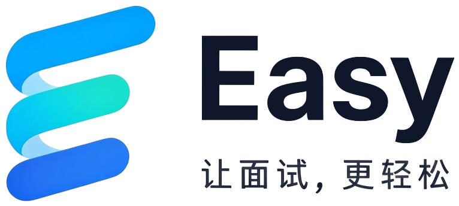
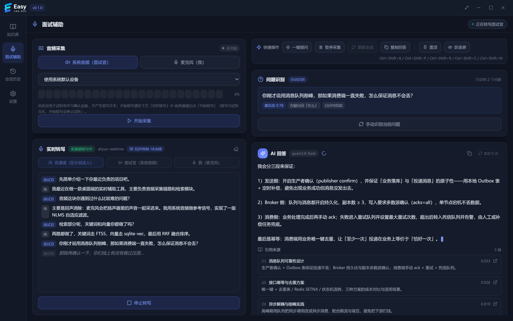
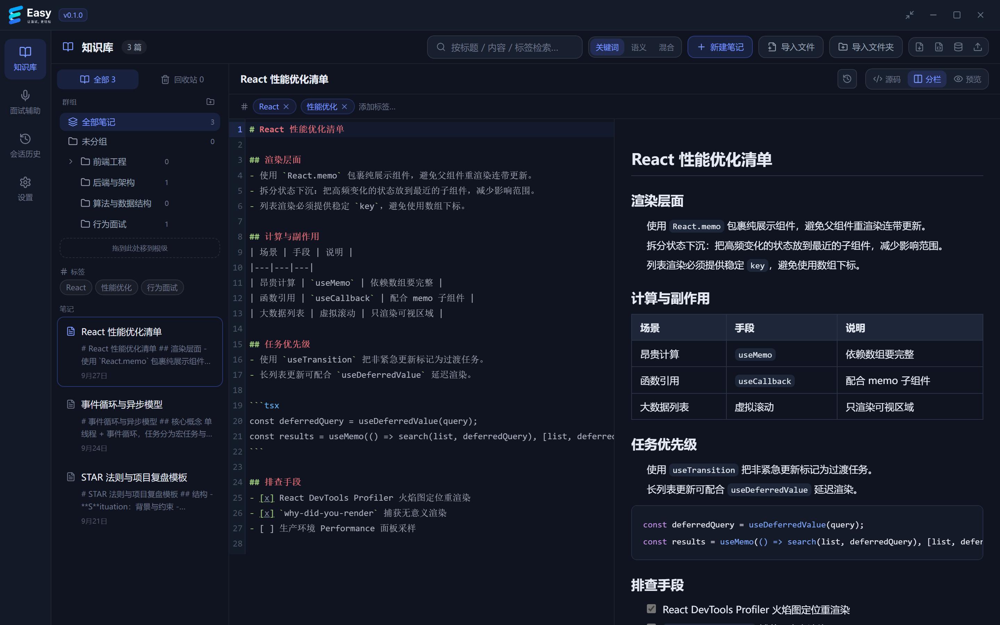
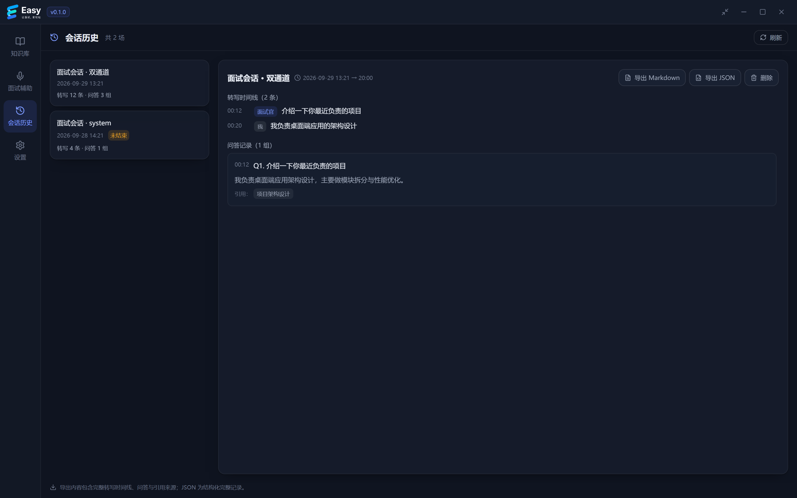
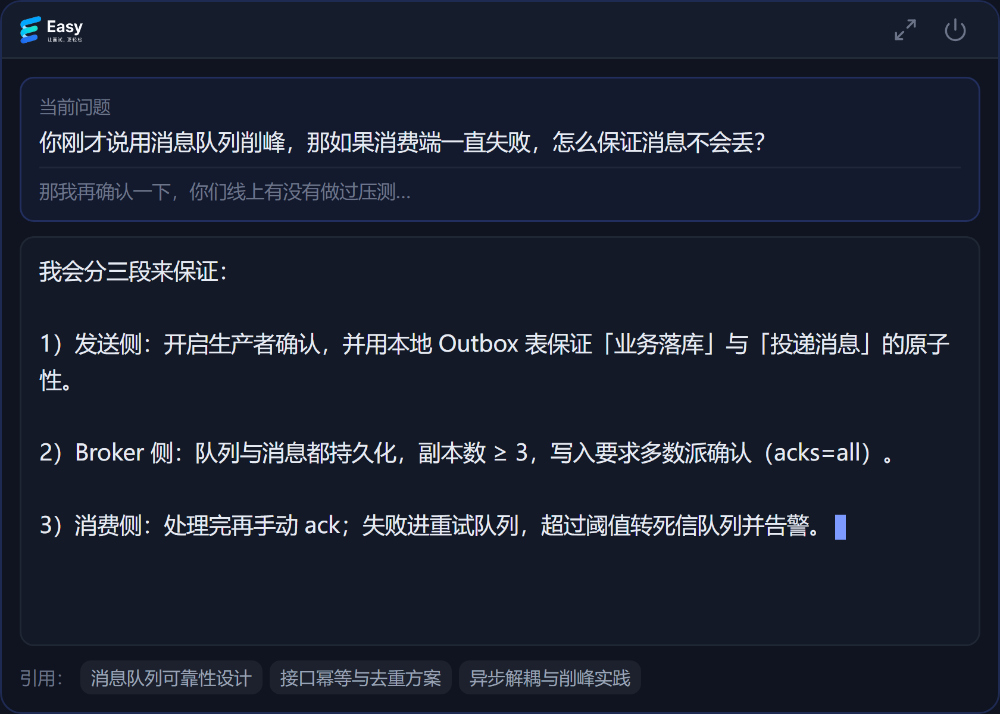
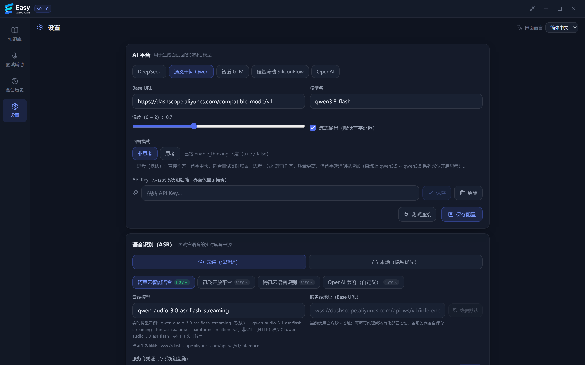

<p align="center">
  <picture>
    <source media="(prefers-color-scheme: dark)" srcset="src/assets/logo-lockup-dark.png">
    
  </picture>
</p>

<h1 align="center">轻松面试 · Easy Interview</h1>

<p align="center">
  一个本地优先的面试辅助桌面应用。面试官正在问什么、你自己的笔记里写过什么、这话可以怎么答，同屏摆在你眼前。
</p>

<p align="center">
  <a href="https://github.com/xiaoxi-li/ai-interview-assistant/actions/workflows/ci.yml"></a>
  
  
  
  
  
</p>

<p align="center">
  <a href="#界面预览">界面预览</a> ·
  <a href="#核心特性">核心特性</a> ·
  <a href="#快速开始">快速开始</a> ·
  <a href="#一键演示">一键演示</a> ·
  <a href="#编译与打包">编译与打包</a> ·
  <a href="#键盘快捷键">快捷键</a> ·
  <a href="#已知限制">已知限制</a> ·
  <a href="#文档">文档</a>
</p>

---

## 目录

- [目录](#目录)
- [界面预览](#界面预览)
- [核心特性](#核心特性)
- [工作原理](#工作原理)
- [环境要求](#环境要求)
- [快速开始](#快速开始)
  - [云端 ASR（目前仅适配阿里云百炼，默认通路）](#云端-asr目前仅适配阿里云百炼默认通路)
  - [本地 ASR 原生推理（可选，当前仅 Windows）](#本地-asr-原生推理可选当前仅-windows)
  - [开箱默认配置](#开箱默认配置)
- [一键演示](#一键演示)
  - [验收清单](#验收清单)
  - [演示模式的真实性边界](#演示模式的真实性边界)
- [编译与打包](#编译与打包)
- [测试与校验](#测试与校验)
- [键盘快捷键](#键盘快捷键)
- [项目结构](#项目结构)
- [已知限制](#已知限制)
- [常见问题](#常见问题)
- [文档](#文档)
- [免责声明](#免责声明)

---

## 界面预览
<p align="center">
  
</p>

<p align="center">面试辅助页分成左右两栏。左边是音频进来到转写出去的链路，一般选双通道，系统音频那一路当面试官，麦克风那一路当我。右边是识别出来的问题、从知识库里捞到的笔记，还有一段一段往外蹦的 AI 回答。</p>

| 知识库 | 会话历史 |
|---|---|
|  |  |
| Markdown 编辑、分栏、预览，中文全文检索加语义检索 | 时间线回放、问答与引用，能导出 Markdown / JSON |

| 迷你模式（就地切换、置顶小窗） | 设置 |
|---|---|
|  |  |
| 面试中按 `Ctrl/Cmd + Shift + M` 缩成浮窗，转写和回答照旧往外流 | AI 平台、语音识别、音频、知识库、界面、隐私，改完当场给结果 |

---

## 核心特性

- 回答来自你自己的笔记。本地知识库先过一遍（FTS5 中文分词管关键词，sqlite-vec 管语义，两路结果用 RRF 融合），再交给模型组织成能直接说出口的话。模型只负责措辞，内容是你写过的。
- 分得清谁在说话。系统音频一路当面试官，麦克风一路当我，各转各的；麦克风这边拿系统音频当参考做 NLMS 回声消除，省得我说话时把喇叭里的声音又收进来一遍。
- 转写有云上和本地两条路。默认走云上，阿里云百炼的实时识别，低延迟，不用先下模型；不想让音频出本机就切本地，跑 `sherpa-onnx` 的 Paraformer。
- 笔记和会话都留在本机。一个 SQLite 文件装下笔记、索引、会话和配置，API Key 进系统钥匙链，不落库。音频上传云端的开关默认开着，随时能关，关了云端转写就会被拦下。
- 有个一键演示，什么都不用准备。没麦克风、没模型、没 API Key，30 秒也能把整条链路跑一遍，先确认环境通不通。
- 装完不占地。免安装 exe 约 12 MB，空闲时工作集 44 MB 上下，挂着不碍事。Windows 10/11 和 macOS 13+ 同一套代码，CI 两个平台跑同一批校验。

---

## 工作原理

整条链路这么走：

```text
① 采集   系统音频（面试官） + 麦克风（我，以系统音频作 AEC 参考）
           ↓  16 kHz 单声道 / 20 ms 帧
② 转写   ASR：云端实时 WebSocket，或本地 sherpa-onnx
           ↓  partial（实时）→ final（落库）
③ 识别   问题识别：按句末标点切句 → 规则打分 → 跨段聚合与去重
           ↓  识别到新问题
④ 召回   知识库混合检索：FTS5（BM25） + 向量 → RRF 融合排序
           ↓  Top-K 片段
⑤ 回答   AI 生成（SSE 流式） →「问题 + 引用来源 + 回答」实时呈现
```

技术栈是 Tauri 2（Rust）+ React 18 + TypeScript + Vite 5 + TailwindCSS + SQLite（FTS5 + sqlite-vec）。

---

## 环境要求

| 依赖 | 版本 | 说明 |
|---|---|---|
| Node.js | ≥ 18（推荐 20 LTS） | 前端构建与测试 |
| Rust | ≥ 1.77（stable） | Tauri 后端 |
| Windows | Windows 10/11 + **WebView2**（系统自带） | 构建 MSI/NSIS 安装包 |
| macOS | 13+ + Xcode Command Line Tools | 构建 .app / .dmg |
| libclang（仅启用本地识别时） | LLVM 18.1.1，**已随仓库提供** | 只有启用 `--features local-asr-native` 时才需要（bindgen 依赖）。不用自己装 LLVM，仓库里带了 `.libclang/bin/libclang.dll` |

> Windows 下请确保 `cargo` 在 PATH 中，否则执行：
> ```powershell
> $env:PATH="$env:USERPROFILE\.cargo\bin;$env:PATH"
> ```

---

## 快速开始

```powershell
git clone https://github.com/xiaoxi-li/ai-interview-assistant.git
cd ai-interview-assistant

npm install                 # 首次安装依赖（约 1 分钟）
$env:PATH="$env:USERPROFILE\.cargo\bin;$env:PATH"

npm run tauri dev           # 启动桌面应用（首次 Rust 编译约 3–6 分钟）
```

`tauri dev` 会同时拉起 Vite 开发服务器（`http://localhost:1420`）和桌面窗口。改前端热更新，改 Rust 自动重编译。

<details>
<summary><b>只想看界面、不装 Rust？可以只跑 Web 版</b></summary>

```powershell
npm run dev        # 打开 http://localhost:1420
```

浏览器里跑的时候，后端 IPC 会自动落到内置 mock（`src/lib/ipc.ts` 加 `src/mocks/`），方便脱离桌面壳调布局。它不产生真实的转写、检索和回答，一键演示那套流式过程也得在桌面壳里才看得到。

</details>

### 云端 ASR（目前仅适配阿里云百炼，默认通路）

云上这条路不用下模型，但得有API Key，而且音频会上传到服务商（本地模式不上传）。默认值已经收敛成「只填一个 Key 就能跑」，下面是确认项：

1. 「设置 → 隐私与安全」里的「允许上传音频至云端 ASR」默认勾着。取消勾选后再点「开始转写」会被拦下并给提示；真的一点都不想上传，就切到「本地（隐私优先）」。
2. 「设置 → 语音识别」默认选中「云端（低延迟）」加「阿里云智能语音」。讯飞、腾讯、OpenAI 兼容这几项写着「待接入」，选中后开始转写会告诉你换哪儿。
3. 在「服务商凭证」里填百炼 API Key。它存在系统钥匙链里，不落库。整份配置里只有这一步必须手填。
4. 服务端地址（Base URL）可选，默认 `wss://dashscope.aliyuncs.com/api-ws/v1/inference`。走代理或者用地域专属域名就自己填一个，每个服务商各存一份，点「恢复默认」能还原官方地址。
5. 云端模型默认是 `qwen-audio-3.0-asr-flash-streaming`。同族的 `qwen-audio-3.1-asr-flash-streaming`、`fun-asr-realtime`、`paraformer-realtime-v2` 实测也能用。注意 `qwen-audio-3.0-asr-flash` 没有 `-streaming` 后缀，那是非实时的 HTTP 模型，填进去会被服务端以 `ModelNotFound` 顶回来。
6. 点「连接测试」，通了会显示耗时，不通会告诉你卡在哪一步，比如没填 Key、地址不合法、鉴权失败、模型名不对、网络不通。测的是表单里当前的值，带着没保存的修改一起测，不用先保存。
7. 保存之后回面试辅助页，选「双通道」开始转写。系统音频那一路当面试官，麦克风那一路当自己。服务端返回的句级结果里，句子没说完的显示成斜体 partial，说完了的落库成 final。

<details>
<summary><b>真实凭证冒烟自检（默认 <code>#[ignore]</code>）</b></summary>

```powershell
$env:DASHSCOPE_API_KEY="sk-xxx"; cargo test --lib -- --ignored real_aliyun --nocapture
```

三个用例分别是握手鉴权（建连拿到 `task-started`）、音频通路（按实时率投递音频，`finish-task` 正常收尾）和错误凭证（HTTP 401，返回一条能照着做的鉴权提示）。默认拿合成音频验证协议通路；想验证真实识别，再加 `$env:ASR_SAMPLE_WAV="<16k 单声道 WAV 路径>"`。`$env:ASR_MODEL=<模型名>` 可以覆盖联调用的模型，用来核对某个模型名会不会被实时端点接受。

</details>

### 本地 ASR 原生推理（可选，当前仅 Windows）

默认构建不带原生识别，不然每台构建机都得先装 libclang。仓库里已经带了一份（`.libclang/bin/libclang.dll`，80 MB，取自 PyPI 的 libclang 包），clone 下来就能用。要用就这么开：

```powershell
# 1) 指向仓库自带的那份（sherpa-rs-sys 用 bindgen 生成 FFI 绑定，运行时需要这个 DLL）。
#    文件丢了或者要换版本：pwsh -File .libclang/fetch.ps1
$env:LIBCLANG_PATH="<仓库路径>\.libclang\bin"

# 2) 开发运行
npm run tauri dev -- --features local-asr-native

# 3) 出安装包：必须额外用 --config 声明随包携带的原生 DLL，
#    否则安装版缺少 DLL 会在启动阶段直接失败（默认构建不受影响，CI 安全）
npm run tauri build -- --features local-asr-native --config src-tauri/tauri.local-asr.conf.json
```

- 第一次带这个特性构建时，`sherpa-rs-sys` 会按 target 下大约 23 MB 的预编译原生库，SHA256 校验完缓存到 `%LOCALAPPDATA%\sherpa-rs\`，之后构建就不下了。
- 开发构建里 DLL 由 `sherpa-rs-sys` 的 `build.rs` 复制到 `target/<profile>/`，跟 exe 放在一起；安装包则由 `tauri.local-asr.conf.json` 的 `bundle.resources` 带进去。
- 开起来之后，去「设置 → 模型管理」下「本地 ASR（Paraformer 中文）」，回面试辅助页开始转写，就有真实的中文转写了。
- 没开这个特性时，相关命令会返回一条明确的构建指引，而不是含糊地甩一句「尚未接入」。就绪状态在「设置 → 语音识别」切到本地模式后的「本地引擎」那里看。
- 冒烟自检（得先下好模型）：`cargo test --features local-asr-native -- --ignored asr::sherpa`。
- macOS 那条路还没接，见 [`ai-doc/需求分析.md`](ai-doc/需求分析.md) 的 TODO-01。

### 开箱默认配置

这几项只在没存过配置时生效，存过的不动。默认值只写在后端配置对象的 `Default` 里（`config/{mod,asr,privacy}.rs`），设置页不另存一份：

| 分区 | 默认值 |
|---|---|
| AI 平台 | **通义千问 Qwen** + 模型 `qwen3.8-flash`（「回答模式」仍默认**非思考**，首字更快） |
| 语音识别 | **云端（低延迟）** + **阿里云智能语音** + 模型 `qwen-audio-3.0-asr-flash-streaming` |
| 隐私与安全 | **允许上传音频至云端 ASR 已勾选** |

这么配的原因挺实际的。Qwen 和阿里云 ASR 都走百炼，共用同一把 DashScope Key，第一次配置只用填一个地方。要是压根不想联网转写，切到「本地（隐私优先）」再把本地模型下下来就行。

---

## 一键演示

这是主要的验收路径，麦克风、模型、API Key 一个都不用准备。

1. 启动应用，`npm run tauri dev`，或者直接双击打好的安装包 / exe。
2. 首次启动会有个 4 步向导，隐私与权限说明、ASR 通路与模型准备、AI 平台配置、完成。验收的时候一路点「下一步」跳过就行。
3. 左侧导航进「面试辅助」。
4. 左上角那张卡片写着「一键演示 · 完整链路」，点「开始演示」。
5. 看大约 30 秒，1x 速度，3 轮问答。
6. 演示途中可以点标题栏的「缩小」，或者按 `Ctrl+Shift+M`，界面会就地换成迷你页，窗口同时缩成小窗并置顶。小窗里一样是逐字往外流的。

### 验收清单

| # | 预期现象 | 所在面板 |
|---|---|---|
| 1 | 自动写入 4 篇示例笔记（架构设计 / 性能优化 / 系统设计 / 团队协作），重复跑不会写第二遍 | 知识库 |
| 2 | 面试官和我两种颜色的气泡交替出现 | 实时转写 |
| 3 | 每条发言先以斜体 partial 冒出，随后被 final 覆盖并落库 | 实时转写 |
| 4 | 3 条面试官提问都被识别，带置信度徽标和命中的信号（比如「以问号结尾」「含疑问词「怎么」」） | 问题识别 |
| 5 | 回答按打字机效果逐字流出，标题上挂着模型名，`offline-demo` 或者你配的那个 | AI 回答 |
| 6 | 回答下面列出引用来源，有标题、摘要和融合得分，点一下跳到知识库并定位到那篇笔记 | AI 回答 |
| 7 | 大约 30 秒后自动收尾，卡片重新冒出来 | 全局 |
| 8 | 「会话历史」里能看到「演示会话 · 全链路」，时间线能回放，问答和引用都在，还能导出 Markdown / JSON | 会话历史 |
| 9 | 点标题栏的「缩小」或按 `Ctrl+Shift+M`，界面就地换成迷你页，窗口缩成小尺寸并置顶。这时候识别到新问题，不用切回完整界面就会自动召回、逐字输出回答。点「恢复完整界面」还原窗口几何 | 全局 |

### 演示模式的真实性边界

演示换掉的只是输入来源，业务逻辑是真的：

| 环节 | 演示中 | 说明 |
|---|---|---|
| 音频 → 文本 | 脚本提供 | 真实转写得靠 ASR 通路 |
| 问题识别 | 真实 | 生产 `QuestionDetector`，按句规则打分，跨段聚合再查重 |
| 知识库召回 | 真实 | 生产混合检索（FTS5 中文分词 + 向量 + RRF 融合），4 篇笔记也是真写进去的 |
| 回答生成 | 真实或离线 | 配了 AI Key 就走真实 SSE 流式；没配就用 `offline_answer` 拼，并在标题上写清「离线演示回答」 |
| 落库 / 事件 / 会话回放 | 真实 | 和正式链路同一套仓储与事件契约 |

所以演示能跑通，等于整条链路端到端验过一遍，只差「音频转文本」那一步。

---

## 编译与打包

```powershell
$env:PATH="$env:USERPROFILE\.cargo\bin;$env:PATH"
npm run tauri build
```

0.1.0 实际编出来的产物在这几个位置，体积只是个参考，版本一变就会有出入。

| 平台 | 路径 | 大小 |
|---|---|---|
| Windows 免安装 exe | `src-tauri/target/release/easy-interview.exe` | ≈ 11.7 MB |
| Windows 安装包（NSIS） | `src-tauri/target/release/bundle/nsis/轻松面试_0.1.0_x64-setup.exe` | ≈ 5.4 MB |
| Windows 安装包（MSI） | `src-tauri/target/release/bundle/msi/轻松面试_0.1.0_x64_zh-CN.msi` | ≈ 6.4 MB |
| macOS | `src-tauri/target/release/bundle/dmg/*.dmg`、`.../macos/*.app` | — |

也可以只出其中一种，快一些。

```powershell
npm run tauri build -- --no-bundle            # 只出免安装 exe
npm run tauri build -- --bundles nsis         # 只出 NSIS 安装包
npm run tauri build -- --bundles msi          # 只出 MSI 安装包
```

> - 前端产物内嵌进二进制，所以一个 exe 直接就能跑，分发不用带 `dist/`。
> - MSI 的语言是 `zh-CN`，在 `src-tauri/tauri.conf.json` 里配好了。产品名是中文的时候，还用默认的 `en-US` 会让 WiX 的 `light.exe` 打包失败。
> - 打包前先把跑着的实例关掉，不然 release 产物被占用，打包会失败。

<details>
<summary><b>安装包手工验签清单</b></summary>

1. 双击安装包完成安装（或直接运行免安装 exe）。
2. 启动后完成首次向导；确认无边框自定义标题栏可拖拽、最小化/最大化/关闭正常。
3. 复跑「一键演示」验收清单 1–9。
4. 「设置」中确认：主题切换（深色 / 浅色 / 跟随系统，点选即时预览、点「保存配置」持久化）、语言切换（中/英）、AI 平台配置、模型管理、隐私设置等页面均可正常打开保存。

</details>

---

## 测试与校验

```powershell
npm run verify            # 前端：类型检查 + 构建 + vitest
cd src-tauri; cargo test  # 后端：单测 + 集成测试
```

`npm run verify` 就是 `npm run build && npm test`。当前基线是前端 356 项（36 个文件）、后端 446 项全过，里面包含 PCM 回放端到端、AEC、双通道、演示链路和命令线程断言。CI 在 Windows 和 macOS 上跑同一批校验（[`.github/workflows/ci.yml`](.github/workflows/ci.yml)），打 `v*` tag 时由 [`release.yml`](.github/workflows/release.yml) 出包并建一个草稿 Release。

> Tauri 里不带 `(async)` 的 `#[tauri::command]` 会在界面主线程上同步跑，这个坑踩过一次：四个主页面互切时点一下要愣几秒才跳。现在命令都异步了，只留 5 个窗口和全局快捷键相关的同步执行，`commands::command_thread_tests` 用源码断言盯着，防止改回去。加新命令请一律写成 `#[tauri::command(async)]`，数据库、文件、设备枚举、钥匙链这类会堵住的操作丢给 `tauri::async_runtime::spawn_blocking`。
> 开发时想看切页耗时，看控制台里的 `[perf] 切页 A → B：xx.xms`（`src/lib/perf.ts`），生产构建不打印。

---

## 键盘快捷键

| 快捷键 | 作用 |
|---|---|
| `Ctrl/Cmd + Shift + A` | 一键提问，立刻识别当前问题并生成回答 |
| `Ctrl/Cmd + Shift + P` | 暂停或继续采集，暂停期间丢掉音频帧，会话和记录留着 |
| `Ctrl/Cmd + Shift + R` | 重新生成回答 |
| `Ctrl/Cmd + Shift + C` | 复制当前回答 |
| `Ctrl/Cmd + Shift + M` | 进入或退出迷你模式 |

这些键可以在面试页的快捷条里改，也可以去「设置 → 界面」改。全局快捷键（应用失焦也吃键）同样在「设置 → 界面」注册。

---

## 项目结构

```text
src/                    前端（React）
  components/interview/ 面试面板：转写 / 问题 / 回答 / 快捷条 / 演示卡 / 迷你页
  pages/                知识库 / 面试辅助 / 会话历史 / 设置 / 首次向导
  stores/               zustand 状态（含 IPC 降级 mock）
  hooks/                事件订阅（转写 / 问题 / 回答）、自动召回与生成、快捷键与主题同步
  mocks/                浏览器调试用的 IPC mock（`npm run dev` 时启用）
src-tauri/src/          后端（Rust）
  asr/                  ASR（通道抽象 / 本地引擎 + VAD 流水线 / 双通道 / 落库；cloud/ = 云端实时 WS）
  audio/                采集（cpal 麦克风 + WASAPI 端点回环）/ VAD / AEC / 设备 / WAV
  interview/            问题识别 / 知识库召回 / 回答生成 / 会话回放
  retrieval/            分块 / 中文分词 / FTS5 / 向量 / RRF 融合
  demo.rs               一键演示脚本与离线链路自检
  tray.rs hotkeys.rs    系统托盘 / 全局快捷键
ai-doc/                 需求分析与技术方案文档
docs/images/            README 配图
```

---

## 已知限制

1. 本地 ASR 只接了 Windows，而且默认关着，要自己带 `local-asr-native` 特性编，构建机还得有 libclang。没开的时候相关命令会返回一条明确的构建指引，不会假装成功，也不会编一段文本糊弄过去。macOS 那条路还没接（TODO-01）。
2. 云上 ASR 目前只有阿里云百炼能用。讯飞、腾讯云、OpenAI 兼容这几家的配置项、凭证和 Base URL 都留着，协议还没写，选中它们开始转写会告诉你该去哪儿改（TODO-10 / TODO-11）。
3. 嵌入推理还是本地确定性 mock，语义召回能用但质量一般。向量那一路不可用的时候会自动退成纯关键词检索，不影响用。选型定了本地 `BAAI/bge-m3`（ONNX，1024 维，约 2.27 GB），从魔搭下（TODO-07）。
4. 隐身模式的开关只在面试页快捷条上，还没搬进「设置 → 界面」（TODO-09）。
5. 自动更新能检查、能提示、能下载，安装那一步得等发布流水线给产物签名之后才生效。
6. 系统音频采集两个平台不一样。Windows 走 WASAPI 端点级回环，直接对着播放设备采，不用开立体声混音，也不用装虚拟声卡；macOS 还得自己装 BlackHole 之类的虚拟回环设备（TODO-06）。
7. 采集面板点「开始采集」时如果没选具体设备，只有系统音频那一路会回退到默认播放设备，麦克风必须在下拉里挑一个，否则报「未指定音频设备」（TODO-04）。
8. 回答模式选「思考」时，思考阶段暂时没有输出。问题识别碰到带疑问词的陈述句，偶尔还是会误判。

---

## 常见问题

<details>
<summary><b>构建与运行</b></summary>

| 现象 | 处理 |
|---|---|
| `npm run tauri dev` 报 `cargo not found` | 把 `%USERPROFILE%\.cargo\bin` 加入 PATH |
| 首次编译很慢 / 卡在 `Compiling` | 正常，Rust 首次全量编译 3–6 分钟 |
| 「设置 → 语音识别」（本地模式）显示「本地引擎：未启用」，或开始转写时报「未启用本地 ASR 原生推理」 | 默认构建不含原生识别；按上文以 `--features local-asr-native` 构建（需 libclang） |
| 报「加载本地 ASR 模型失败」 | 模型文件损坏或下载不完整；在「设置 → 模型管理」删除后重新下载 |

</details>

<details>
<summary><b>云端 ASR 连接测试失败</b></summary>

| 现象 | 处理 |
|---|---|
| 报「需要上传音频」 | 这个开关默认是开的，看到这条提示说明之前手动关过。去「设置 → 隐私与安全」重新勾上，或者切回「本地（隐私优先）」，本地模式不上传音频 |
| 报「XX 的云端 ASR 待接入」 | 当前仅「阿里云智能语音」已接入；切换服务商或改用本地模式 |
| 报 HTTP 404 | 多半是地址填成了 HTTP 接口。百炼的 `https://dashscope.aliyuncs.com/compatible-mode/v1` 是 OpenAI 兼容的 HTTP 接口，给对话、嵌入和录音文件转写用，实时转写必须走 WebSocket，也就是 `wss://dashscope.aliyuncs.com/api-ws/v1/inference`。点「恢复默认」或者手填这个地址，保存配置再测 |
| 报 ModelNotFound | 这个模型名不能用于实时转写。非实时的 HTTP 文件转写模型（比如 `qwen-audio-3.0-asr-flash`，没有 `-streaming` 后缀）只能走 HTTP 接口。换成实测可用的实时模型，`qwen-audio-3.0-asr-flash-streaming`（默认）、`qwen-audio-3.1-asr-flash-streaming`、`fun-asr-realtime`、`paraformer-realtime-v2` |
| 连接测试失败（其他） | 按提示一项项看，凭证保存了没有、Base URL 通不通（走代理或私有化部署得自己填）、网络有没有问题 |

</details>

<details>
<summary><b>识别不到问题 / 不生成回答</b></summary>

| 现象 | 处理 |
|---|---|
| 转写面板里明明有问题句，但「问题识别」一直为空、AI 回答也不生成 | 先看通道是不是选错了。只有「面试官」那一路的转写参与识别，单通道模式要选「面试官（系统音频）」，双通道模式要确认面试官的话标成了「面试官」而不是「我」。再看判定单位是句，已经按句末标点切句打分，但纯陈述句、疑问特征太弱、或者跟上一个问题高度重复的句子不会上报。还不行就点「手动识别当前问题」，拿最近 30 秒的转写兜底。排查日志在 `<数据目录>/logs/app.log.<日期>`，命中会写 `识别到面试问题（字数/得分/来源）` |
| 召回没有结果 | 确认演示已执行（会自动写入 4 篇示例笔记），或先在「知识库」导入 Markdown |
| 演示时没有 AI 回答内容 | 未配 Key 时会用离线回答；若报错请检查「设置 → AI 平台」的 Base URL 与 Key |
| 报「未检测到可用的系统音频来源」 | Windows：确认系统至少有一个可用播放设备，并在「设置 → 音频设备」点「刷新设备」；macOS：安装 BlackHole 等虚拟回环设备后重启应用 |
| 采集面板点「开始采集」报「未指定音频设备」 | 麦克风来源需在下拉中选中具体设备；系统音频来源可直接用系统默认播放设备 |

</details>

<details>
<summary><b>界面与数据</b></summary>

| 现象 | 处理 |
|---|---|
| 选了「浅色」切到别的页面后界面又变回原来的主题 | 主题是**即时预览**：点选立刻生效但**不落库**，需在该分区点「保存配置」才持久化；未保存就离开设置页会自动回滚（避免误改） |
| 想让界面跟随系统深浅色 | 「设置 → 界面与快捷键 → 主题」选「跟随系统」，之后系统切换时界面实时变化，重启仍保持；系统主题不可用时回退深色 |
| 想重置全部数据重来一遍 | 关闭应用后删除数据目录：Windows `%APPDATA%\com.easyinterview.app\`，macOS `~/Library/Application Support/com.easyinterview.app\`（内含 `easy-interview.db` 与 `models/`），下次启动会重新初始化并再次进入首次向导。API Key 存在系统钥匙链中，如需一并清除请在「设置 → AI 平台」中删除 |

</details>

---

## 文档

| 文档 | 内容 |
|---|---|
| [`ai-doc/需求分析.md`](ai-doc/需求分析.md) | 场景与用例、功能需求（KB/IA/ST/SYS）、非功能需求、验收标准、待办清单、需求追溯矩阵 |
| [`ai-doc/技术方案.md`](ai-doc/技术方案.md) | 技术选型、系统架构、核心模块设计、数据模型、关键技术决策与风险 |
| [`docs/images/`](docs/images) | README 配图（由 Web 版 mock 数据渲染，非真实会话内容） |

---

## 免责声明

这个项目是拿来做面试准备和练习的。真去参加面试之前，请自己先确认招聘方和面试平台允不允许用辅助工具，以及你所在的地方还有没有别的规定。用不用、怎么用，后果自负。
